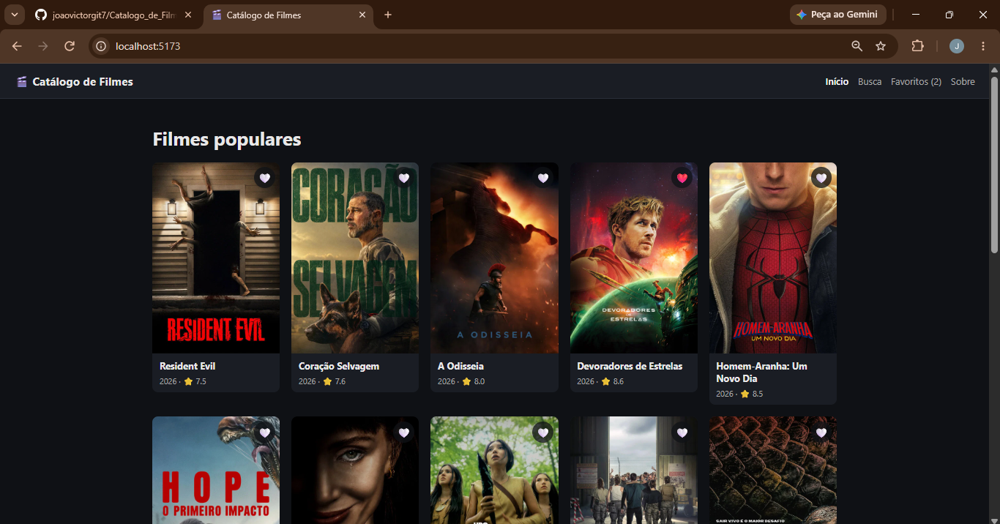
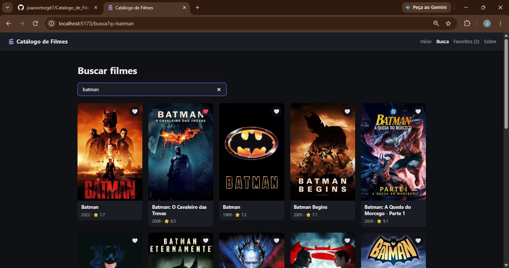
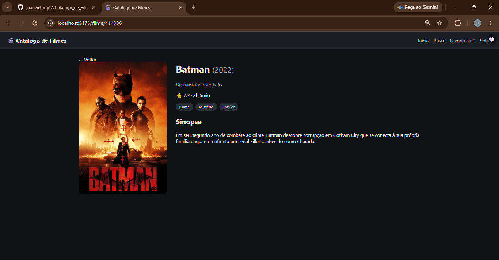
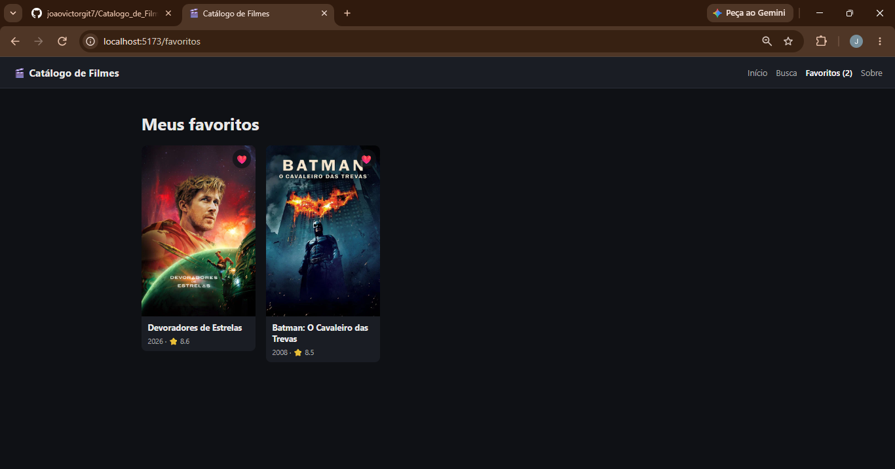
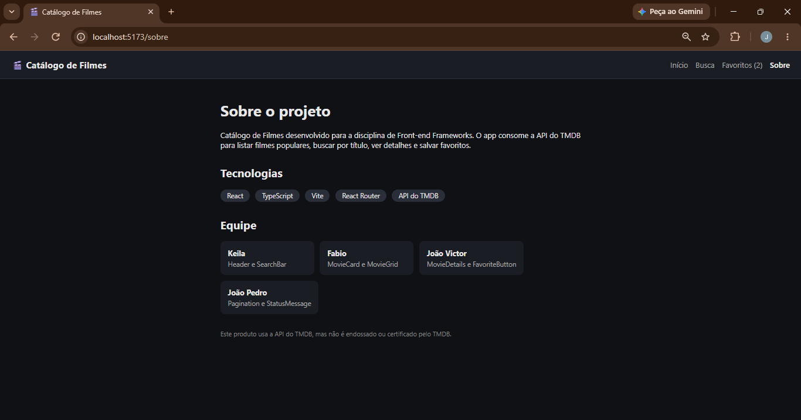

# 🎬 Catálogo de Filmes

Aplicação web desenvolvida em **React + TypeScript** para o Trabalho Final da disciplina **Front-end Frameworks** (Ciência da Computação, AV2).

O app consome a API do [TMDB](https://www.themoviedb.org/) para listar filmes populares, buscar por título, ver detalhes e salvar favoritos.

## Funcionalidades

- Lista de filmes populares com **paginação**
- **Busca por título** com *debounce* (a API só é chamada quando o usuário para de digitar)
- Página de **detalhes** do filme (pôster, nota, duração, gêneros e sinopse)
- **Favoritos** salvos no navegador (`localStorage`), com contador no menu
- Tratamento de carregamento e de erros

## Tecnologias

- [React](https://react.dev/) 
- [TypeScript](https://www.typescriptlang.org/)
- [Vite](https://vite.dev/)
- [React Router](https://reactrouter.com/)
- [API do TMDB](https://developer.themoviedb.org/)

## Requisitos do trabalho

| Requisito | Atendimento |
|---|---|
| Mínimo de 8 componentes funcionais (2 por integrante) | 8 componentes (veja a tabela abaixo) |
| Mínimo de 5 páginas distintas | Home, Busca, Detalhes, Favoritos e Sobre |
| Mínimo de 4 hooks diferentes | `useState`, `useEffect`, `useDebounce` e `useFavorites` (além de `useParams`, `useNavigate` e `useSearchParams`, do React Router) |
| TypeScript obrigatório | Todo o projeto em `.ts` / `.tsx`, com interfaces para os dados e props tipadas |
| Integração com API (opcional) | API do TMDB |

## Como instalar e usar

### Pré-requisitos

- [Node.js](https://nodejs.org/) 18 ou superior
- Uma conta gratuita no [TMDB](https://www.themoviedb.org/) para gerar o token da API

### Passo a passo

1. Clone o repositório e entre na pasta:

   ```bash
   git clone https://github.com/joaovictorgit7/Catalogo_de_Filmes.git
   cd Catalogo_de_Filmes
   ```

2. Instale as dependências:

   ```bash
   npm install
   ```

3. Gere o token da API: no TMDB, vá em **Configurações → API** e copie o **Token de Acesso de Leitura da API** (o texto longo que começa com `eyJ`).

4. Crie um arquivo `.env` na raiz do projeto (use o `.env.example` como modelo):

   ```
   VITE_TMDB_TOKEN=cole_aqui_o_seu_token
   ```

5. Inicie o servidor de desenvolvimento:

   ```bash
   npm run dev
   ```

6. Abra o endereço mostrado no terminal (normalmente `http://localhost:5173`).

Para gerar a versão de produção: `npm run build`.

## Páginas

| Página | Rota |
|---|---|
| Home (filmes populares) | `/` |
| Busca | `/busca` |
| Detalhes do filme | `/filme/:id` |
| Favoritos | `/favoritos` |
| Sobre | `/sobre` |

## Componentes e responsáveis

| Integrante | Componentes | Descrição |
|---|---|---|
| Keila | `Header` | Menu de navegação com contador de favoritos |
| | `SearchBar` | Campo de busca controlado |
| Fabio | `MovieCard` | Card com pôster, título, ano e nota |
| | `MovieGrid` | Grade que renderiza a lista de cards |
| João Victor | `MovieDetails` | Conteúdo completo da página de detalhes |
| | `FavoriteButton` | Botão de favoritar (coração) |
| João Pedro | `Pagination` | Botões de página anterior e próxima |
| | `StatusMessage` | Mensagem de carregamento ou de erro |

## Hooks

| Hook | Onde é usado |
|---|---|
| `useState` | Estados das páginas e componentes (filmes, página atual, carregamento, erro) |
| `useEffect` | Buscas na API e escuta de eventos |
| `useDebounce` (customizado) | Atrasa a busca até o usuário parar de digitar (`src/hooks/useDebounce.ts`) |
| `useFavorites` (customizado) | Lê e grava os favoritos no `localStorage` (`src/hooks/useFavorites.ts`) |

## Estrutura do projeto

```
src/
├── components/   # componentes reutilizáveis
├── hooks/        # hooks customizados
├── pages/        # páginas (uma por rota)
├── services/     # comunicação com a API do TMDB
├── types/        # interfaces TypeScript
├── App.tsx       # rotas
└── main.tsx      # ponto de entrada
```

## Telas

### Home


### Busca


### Detalhes


### Favoritos


### Sobre


## Créditos

Este produto usa a API do TMDB, mas não é endossado ou certificado pelo TMDB.
